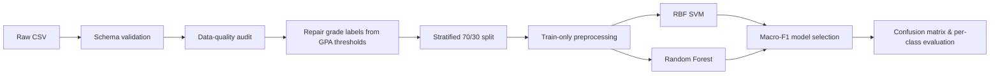
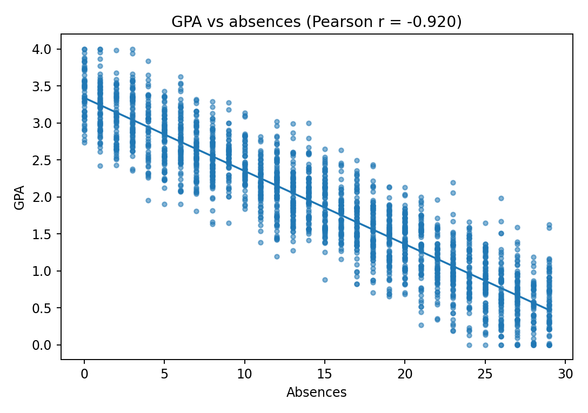
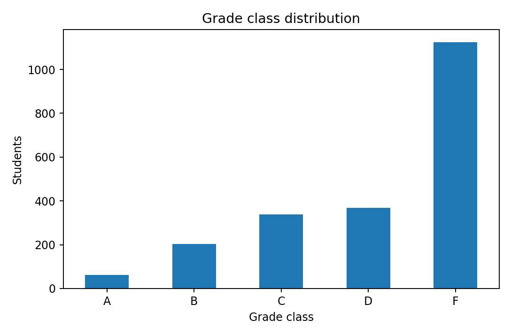
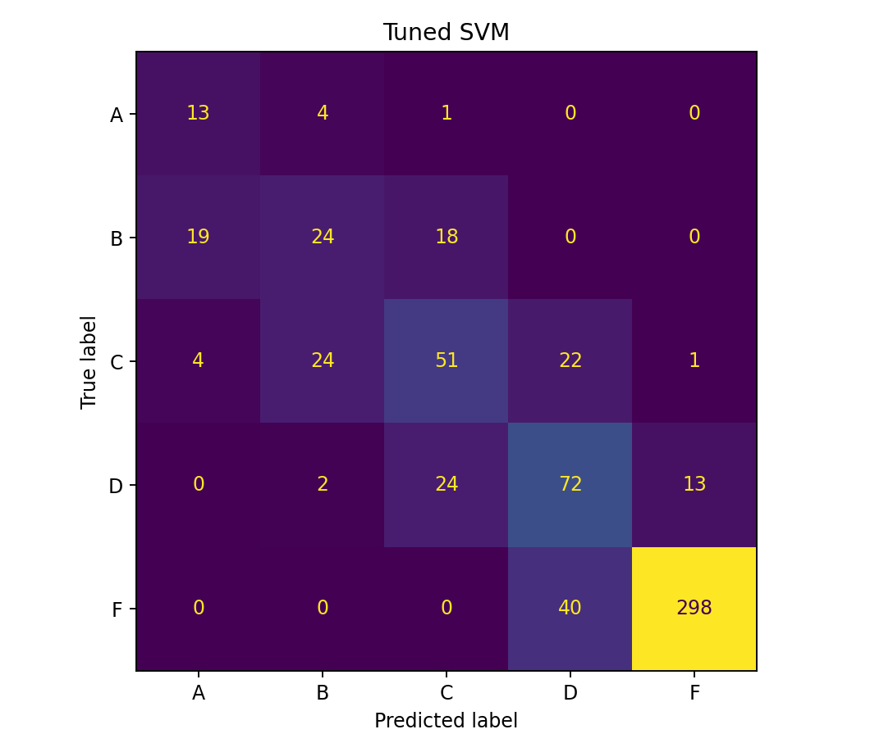

# Student Performance ML Pipeline

**English** · [中文](README.zh-CN.md)

[](#)
[](#)
[](LICENSE)

A leakage-safe, reproducible machine-learning pipeline for **multi-class student grade prediction** using Python and scikit-learn. The project covers data-quality auditing, exploratory analysis, feature preprocessing, SVM and Random Forest baselines, macro-F1-driven model selection, and reproducible evaluation.

> **Project context:** this repository is a **2026 portfolio refactor** of concepts and code developed during Monash University FIT1043 *Introduction to Data Science*. It is not the original assessment submission and does not include assignment specifications, marking rubrics, course solutions, student-identifying files, or the original course-distributed dataset.

## Why this project

The original coursework was useful for learning the full data-science workflow, but the notebook depended on Jupyter kernel state and performed some preprocessing before the train/test split. This refactor turns the work into a clean portfolio project with reusable modules, tests, CI, and preprocessing contained inside sklearn pipelines.

Key improvements include:

- median imputation learned **only from training folds**;
- explicit removal of identifier and leakage-prone features (`StudentID`, `GPA`);
- categorical encoding inside the model pipeline;
- stratified train/test splitting for an imbalanced five-class target;
- model selection based on **macro-F1**, not accuracy alone;
- reproducible scripts, unit tests, and GitHub Actions CI;
- clear separation between source code, notebooks, raw data, and generated results.

## Pipeline



## Data-quality checks

The course-prepared dataset intentionally contained issues for cleaning practice. During the refactor run:

| Check | Result |
| --- | ---: |
| Input rows | 2,100 |
| Invalid `Absences` rows removed | 2 |
| Grade-label mismatches detected | 100 |
| Missing `StudyTimeWeekly` values left for train-only imputation | 21 |
| Rows used after deterministic cleaning | 2,098 |

The label audit uses the documented thresholds:

- A: GPA ≥ 3.5
- B: 3.0 ≤ GPA < 3.5
- C: 2.5 ≤ GPA < 3.0
- D: 2.0 ≤ GPA < 2.5
- F: GPA < 2.0

`GPA` is used only to audit/repair the label and is then **excluded from predictors** to avoid target leakage.

## Exploratory finding

One of the strongest relationships in the course-prepared data is between GPA and absences.



The target is also strongly imbalanced, with class F accounting for more than half of the observations.



## Model results

The following results were generated from the original 2,100-row course-prepared dataset using the refactored pipeline. The raw course file is intentionally not included.

| Model | Accuracy | Macro-F1 | Balanced accuracy |
| --- | ---: | ---: | ---: |
| Baseline RBF SVM | 0.714 | 0.565 | 0.605 |
| Random Forest | 0.721 | 0.528 | 0.518 |
| **Tuned RBF SVM** | **0.727** | **0.585** | **0.629** |

The tuned SVM was selected by **5-fold stratified cross-validation on macro-F1**. Its best configuration in this refactor used `RobustScaler`, `C=15`, and `gamma=0.2`, with cross-validation macro-F1 ≈ **0.597**.



### Why macro-F1?

Accuracy alone can look acceptable even when minority grade classes are poorly predicted. Macro-F1 gives each class equal weight, making it a more informative primary selection metric for this imbalanced five-class problem.

## Repository structure

```text
student-performance-ml-pipeline/
├── .github/workflows/ci.yml
├── data/
│   ├── README.md
│   └── raw/                  # git-ignored
├── notebooks/
│   └── analysis.ipynb
├── results/
│   ├── metrics.csv
│   ├── data_audit.csv
│   ├── *_classification_report.csv
│   └── *.png
├── scripts/
│   └── run_experiment.py
├── src/student_performance/
│   ├── data.py
│   ├── evaluate.py
│   └── modeling.py
├── tests/
├── pyproject.toml
└── requirements.txt
```

## Dataset

The underlying public dataset is commonly distributed as **Students Performance Dataset** on Kaggle and contains 2,392 anonymised records:

https://www.kaggle.com/datasets/rabieelkharoua/students-performance-dataset

The university exercise used a course-prepared subset with selected columns and injected data-quality problems. That exact course file is **not redistributed** here. See [`data/README.md`](data/README.md) for the expected schema.

## Quick start

### 1. Create an environment

```bash
python3 -m venv .venv
source .venv/bin/activate
python -m pip install --upgrade pip
pip install -e ".[dev]"
```

### 2. Add a compatible dataset

Place your CSV at:

```text
data/raw/student_performance.csv
```

### 3. Run the complete experiment

```bash
python scripts/run_experiment.py \
  --data data/raw/student_performance.csv \
  --output-dir results
```

For a faster baseline-only run:

```bash
python scripts/run_experiment.py \
  --data data/raw/student_performance.csv \
  --output-dir results \
  --skip-tuning
```

### 4. Run tests

```bash
pytest -q
```

## Technical notes

### Leakage prevention

The refactor deliberately keeps missing feature values intact during deterministic cleaning. `SimpleImputer` is fitted inside the sklearn pipeline after the train/test split, so test data cannot influence training medians.

### Feature set

The portfolio version uses:

- `Age`
- `StudyTimeWeekly`
- `Absences`
- `ParentalSupport`

It excludes:

- `StudentID` — identifier, not a meaningful predictor;
- `GPA` — directly determines the target label and would cause target leakage.

### Models

- **RBF SVM** with class balancing and scaled numeric features;
- **Random Forest** as a nonlinear tree-based comparison;
- **GridSearchCV** over SVM scaling strategy, `C`, and `gamma`, scored by macro-F1.

## Limitations

- The target classes are substantially imbalanced.
- The small feature set cannot capture many factors that affect academic performance.
- Correlation does not imply causation; absence and study-time relationships should not be interpreted causally.
- The course-prepared data includes synthetic or deliberately modified quality issues, so this repository is a technical demonstration rather than an educational policy model.

## Academic-integrity note

This repository is a post-course portfolio refactor. It intentionally excludes Monash teaching materials, assessment specifications, rubrics, official solutions, and original submission artifacts. The goal is to demonstrate the engineering and data-science techniques independently rather than publish an answer repository.

## License

Code in this repository is released under the [MIT License](LICENSE). Dataset licensing and redistribution terms are separate and remain with the original data provider.
