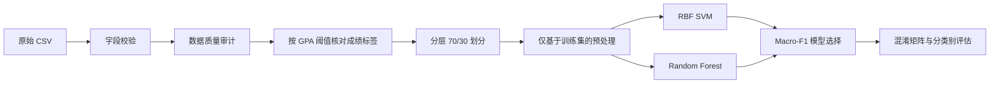

[](#)
[](#)
[](LICENSE)
# 学生成绩机器学习流水线

[English](README.md) · **中文**

这是一个使用 Python 与 scikit-learn 构建的、**可复现且避免数据泄漏**的多分类机器学习项目，用于预测学生成绩等级。项目涵盖数据质量审计、探索性数据分析、特征预处理、SVM 与随机森林基线模型、基于 Macro-F1 的模型选择以及可复现评估。

> **项目背景：** 本仓库是我在 2026 年基于 Monash University FIT1043 *Introduction to Data Science* 中学习和完成的相关内容进行的**作品集重构**。它不是原始作业提交版本，也不包含作业题目、评分标准、课程答案、带有学生身份信息的文件或课程原始数据集。

## 为什么要重构

原课程作业覆盖了较完整的数据科学流程，但原 notebook 存在依赖 Jupyter kernel 历史状态、部分预处理发生在 train/test split 之前等问题。本项目将其整理为适合公开展示的工程化版本：模块化代码、测试、CI，以及全部放在 sklearn Pipeline 内完成的训练期预处理。

主要改进包括：

- 中位数填补仅从**训练数据 / 训练折**中学习；
- 明确排除 `StudentID` 和会造成目标泄漏的 `GPA`；
- 类别编码放入模型 Pipeline；
- 对五分类不平衡目标采用 stratified train/test split；
- 模型选择以 **Macro-F1** 为主要指标，而不是只看 Accuracy；
- 提供可复现实验脚本、单元测试和 GitHub Actions CI；
- 将源码、Notebook、原始数据和实验结果清晰分离。

## 流程



## 数据质量审计

课程准备的数据集中故意加入了一些数据质量问题，用于练习数据清洗。重构实验中检测到：

| 检查项 | 结果 |
| --- | ---: |
| 输入行数 | 2,100 |
| 删除的异常 `Absences` 行 | 2 |
| 检测到的成绩标签不一致 | 100 |
| 留给训练 Pipeline 填补的 `StudyTimeWeekly` 缺失值 | 21 |
| 确定性清洗后使用的行数 | 2,098 |

成绩等级使用以下规则核对：

- A：GPA ≥ 3.5
- B：3.0 ≤ GPA < 3.5
- C：2.5 ≤ GPA < 3.0
- D：2.0 ≤ GPA < 2.5
- F：GPA < 2.0

`GPA` 只用于检查 / 修复标签，之后从预测特征中**完全排除**，以防止 target leakage。

## 探索性分析发现

在课程准备的数据中，GPA 与缺勤次数之间存在非常明显的负相关关系。


目标类别也明显不平衡，F 类超过全部样本的一半。


## 模型结果

以下结果来自对原始 2,100 行课程数据运行重构后的 Pipeline。原始课程数据文件不会随仓库公开。

| 模型 | Accuracy | Macro-F1 | Balanced Accuracy |
| --- | ---: | ---: | ---: |
| 基础 RBF SVM | 0.714 | 0.565 | 0.605 |
| Random Forest | 0.721 | 0.528 | 0.518 |
| **调参 RBF SVM** | **0.727** | **0.585** | **0.629** |

调参 SVM 使用 **5-fold stratified cross-validation + Macro-F1** 进行选择。此次重构中的最佳配置为 `RobustScaler`、`C=15`、`gamma=0.2`，交叉验证 Macro-F1 约为 **0.597**。


### 为什么主要看 Macro-F1？

当类别分布不平衡时，仅看 Accuracy 可能掩盖少数类别预测效果较差的问题。Macro-F1 对每个类别赋予同等权重，更适合这个五分类任务的模型选择。

## 仓库结构

```text
student-performance-ml-pipeline/
├── .github/workflows/ci.yml
├── data/
│   ├── README.md
│   └── raw/                  # 已加入 .gitignore
├── notebooks/
│   └── analysis.ipynb
├── results/
│   ├── metrics.csv
│   ├── data_audit.csv
│   ├── *_classification_report.csv
│   └── *.png
├── scripts/
│   └── run_experiment.py
├── src/student_performance/
│   ├── data.py
│   ├── evaluate.py
│   └── modeling.py
├── tests/
├── pyproject.toml
└── requirements.txt
```

## 数据集

底层公开数据通常以 **Students Performance Dataset** 名称发布在 Kaggle，共包含 2,392 条匿名学生记录：

https://www.kaggle.com/datasets/rabieelkharoua/students-performance-dataset

课程使用的是经过筛选并加入数据质量问题的版本，因此**不会在本仓库中重新分发课程原始文件**。所需字段请参阅 [`data/README.md`](data/README.md)。

## 快速运行

### 1. 创建环境

```bash
python3 -m venv .venv
source .venv/bin/activate
python -m pip install --upgrade pip
pip install -e ".[dev]"
```

### 2. 放入兼容数据集

将 CSV 放到：

```text
data/raw/student_performance.csv
```

### 3. 完整运行实验

```bash
python scripts/run_experiment.py \
  --data data/raw/student_performance.csv \
  --output-dir results
```

如果只想快速运行基础模型：

```bash
python scripts/run_experiment.py \
  --data data/raw/student_performance.csv \
  --output-dir results \
  --skip-tuning
```

### 4. 运行测试

```bash
pytest -q
```

## 技术说明

### 防止数据泄漏

确定性清洗阶段不会提前填补缺失特征。`SimpleImputer` 被放在 sklearn Pipeline 内，并在划分训练 / 测试数据之后才拟合，因此测试集不会影响训练中使用的中位数。

### 使用的特征

公开作品集版本使用：

- `Age`
- `StudyTimeWeekly`
- `Absences`
- `ParentalSupport`

明确排除：

- `StudentID`：仅为标识符，没有合理预测含义；
- `GPA`：它直接决定成绩等级，作为特征会产生严重 target leakage。

### 模型

- **RBF SVM**：类别权重平衡 + 数值特征缩放；
- **Random Forest**：作为非线性树模型对照；
- **GridSearchCV**：对 SVM 的缩放方式、`C` 和 `gamma` 搜索，并以 Macro-F1 作为评分指标。

## 局限性

- 目标类别明显不平衡；
- 当前特征数量有限，无法覆盖所有影响学习成绩的因素；
- 相关性不能证明因果关系，缺勤与学习时间等变量不能被直接解释为因果效果；
- 课程数据包含人为加入 / 修改的数据质量问题，因此该仓库是技术能力展示，不应被视为教育政策模型。

## 学术诚信说明

这是课程结束后的作品集重构。仓库刻意排除了 Monash 教学资料、作业题目、rubric、官方答案以及原始提交文件，目的只是独立展示其中涉及的软件工程与数据科学技术，而不是建立课程答案库。

## License

本仓库代码使用 [MIT License](LICENSE)。数据集本身的许可与再分发条款由原始数据提供方决定，与本仓库代码许可分开。
